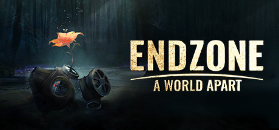

**Endzone: A World Apart is the post-apocalyptic city-builder where survivors emerging from nuclear shelters must rebuild society while managing radiation levels, drought, raider attacks, and contaminated soil in a devastated world.**

---

## 📖 About

Endzone: A World Apart is the post-apocalyptic city-builder where survivors emerging from nuclear shelters must rebuild society while managing radiation levels, drought, raider attacks, and contaminated soil in a devastated world.

## ⚠️ Problems Without Trainer

| Problem | Status |
|---------|--------|
| **Radiation Management** — Contaminated zones require constant monitoring and protective measures | ✅ Solved |
| **Raider Attacks** — Mid-game raider assault waves require established military presence to defend | ✅ Solved |
| **Drought Events** — Extended drought without water reserves causes food production collapse | ✅ Solved |
| **Scavenge Expeditions** — Managing scavenging party survival is an additional resource drain | ✅ Solved |

## ✅ Solution

The **Endzone: A World Apart Trainer** solves all these issues by giving you complete control over the game.

## 🎯 Full Feature List

- Unlimited Resources
- God Mode / Invincibility
- Instant Skill Cooldown
- One-Hit Kill
- Freeze Game Timer
- Unlock All Items & Achievements
- Custom Speed Multiplier
- Save State Anywhere

## 🚀 Quick Start

1. **Disable Windows Defender** temporarily (trainer may trigger false positive)
2. Download the trainer from the button above
3. Launch Endzone: A World Apart
4. Run the trainer as Administrator
5. Activate desired cheats with hotkeys

## 💎 Free vs Paid

| Feature | Free | Pro |
|---------|------|-----|
| Basic God Mode | ✅ | ✅ |
| Unlimited Resources | ✅ | ✅ |
| All Advanced Cheats | ❌ | ✅ |
| Auto-Updates | ❌ | ✅ |
| Priority Support | ❌ | ✅ |

## 💻 Requirements

- Windows 10/11 (64-bit)
- Endzone: A World Apart (any version)
- .NET Framework 4.8+
- DirectX 11+

## 🍎 macOS

macOS users can use our alternative tool:

## ⚖️ Legal

This trainer is for educational and single-player use only. Use responsibly.

---

